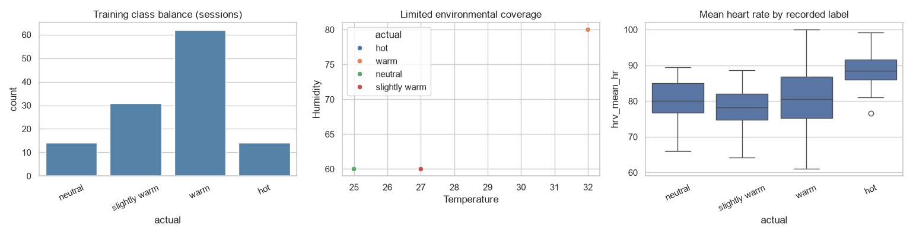
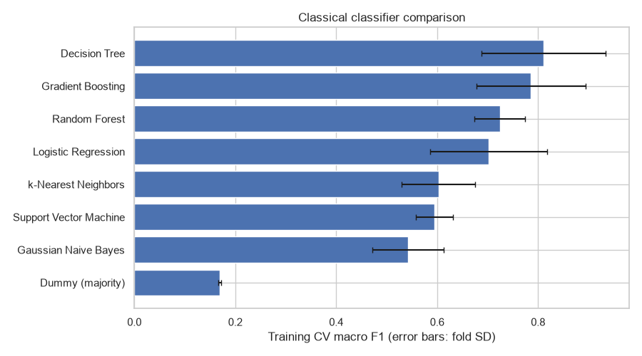
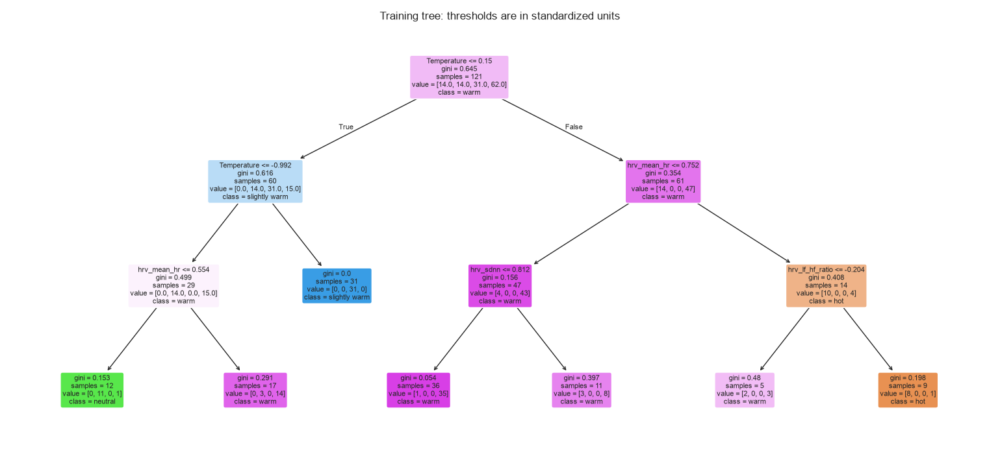
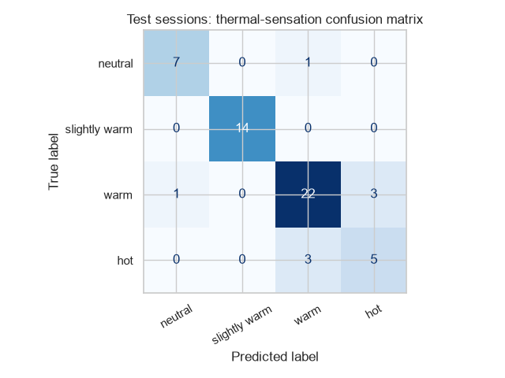
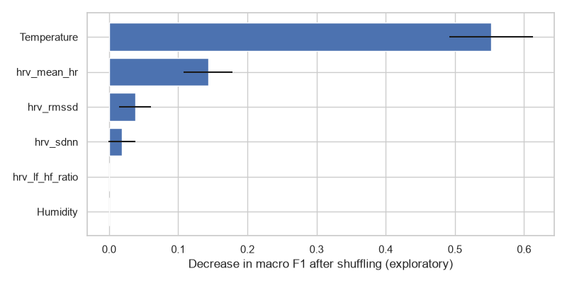

# MCS306: Multimodal Thermal Sensation Prediction

A machine learning framework for predicting individual thermal sensation from environmental conditions (ambient temperature, relative humidity) and physiological heart rate variability (HRV) signals. The project implements a subject-independent evaluation pipeline to prevent data leakage across participants.

---

## Table of Contents

- [Overview](#overview)
- [Repository Structure](#repository-structure)
- [Dataset & Features](#dataset--features)
  - [Feature Set](#feature-set)
  - [Target Variable](#target-variable)
  - [Session Aggregation](#session-aggregation)
- [Methodology & Pipeline](#methodology--pipeline)
  - [Preprocessing](#preprocessing)
  - [Cross-Validation Strategy](#cross-validation-strategy)
  - [Evaluated Classifiers](#evaluated-classifiers)
  - [Hyperparameter Optimization](#hyperparameter-optimization)
  - [Environmental Comparator](#environmental-comparator)
  - [Model Interpretability & Error Diagnostics](#model-interpretability--error-diagnostics)
- [Visualizations](#visualizations)
- [Installation & Usage](#installation--usage)
  - [Prerequisites](#prerequisites)
  - [Data Configuration](#data-configuration)
  - [Running the Code](#running-the-code)

---

## Overview

Accurate prediction of individual thermal comfort is critical for personal comfort systems (PCS) and energy-efficient building climate control. This project explores whether combining wearable physiological monitoring (HRV) with ambient environmental sensors improves thermal sensation classification over environmental measurements alone.

Key engineering safeguards implemented in this pipeline:
- **Zero-Subject Leakage**: Training and test sets contain disjoint participant cohorts (`overlap = set(train.subject) & set(test.subject) == empty`).
- **Stratified Group Cross-Validation**: Folds are partitioned by participant identity (`StratifiedGroupKFold`) so that no individual's sessions appear simultaneously in training and validation splits.
- **Environmental Baseline Benchmark**: Includes a rule-based environmental lookup comparator to test whether complex classifiers learn physiological relationships rather than memorizing room climate setpoints.

---

## Repository Structure

```text
MCS306_FCO/
│
├── DATA/
│   ├── Train2021.csv            # Raw continuous sensor records for training participants
│   └── Test Data.csv            # Raw continuous sensor records for unseen test participants
│
├── Visualization/
│   ├── Figure_1.png             # EDA: Class balance, temperature-humidity coverage, mean HR
│   ├── Figure_2.png             # Cross-validation performance across classical classifiers
│   ├── Figure_3.png             # Interpretable Decision Tree decision boundary visualization
│   ├── Figure_4.png             # Test set confusion matrix
│   └── Figure_5.png             # Permutation feature importance on the held-out test set
│
├── Code.py                      # End-to-end data processing, CV, modeling, and evaluation script
└── README.md                    # Project documentation
```

---

## Dataset & Features

The raw dataset contains continuous sensor measurements gathered during climate chamber experiments with subjects performing tasks under varying thermal conditions and room configurations.

### Feature Set

The modeling pipeline focuses on 6 key predictive features spanning environmental conditions and autonomic nervous system (ANS) responses:

| Feature Name | Category | Description |
| :--- | :--- | :--- |
| `Temperature` | Environmental | Ambient room temperature (°C) |
| `Humidity` | Environmental | Ambient relative humidity (%) |
| `hrv_mean_hr` | Physiological | Mean heart rate (beats per minute) |
| `hrv_rmssd` | Physiological | Root mean square of successive RR interval differences (ms) |
| `hrv_sdnn` | Physiological | Standard deviation of NN intervals (ms) |
| `hrv_lf_hf_ratio` | Physiological | Ratio of low-frequency to high-frequency HRV power |

### Target Variable

The target variable is **`Thermal sensation`**, mapped across 4 ordinal states:
1. `neutral`
2. `slightly warm`
3. `warm`
4. `hot`

### Session Aggregation

To avoid high-frequency time-series autocorrelation bias from inflating classification performance, the pipeline groups records by `['subject', 'experiment']`:
- Computes the median of each numeric feature across the session.
- Extracts the single consensus thermal sensation label per session.

---

## Methodology & Pipeline

### Preprocessing
All models run inside a Scikit-Learn `Pipeline` consisting of:
1. **`SimpleImputer(strategy='median')`**: Handles any missing sensor readings.
2. **`StandardScaler()`**: Standardizes features to zero mean and unit variance.
3. **`Estimator`**: The downstream classifier.

### Cross-Validation Strategy
- **Type**: 4-Fold `StratifiedGroupKFold` (`random_state=42`).
- **Grouping Attribute**: `subject`. Folds ensure that an entire participant's data is isolated to either the fit fold or the validation fold.
- **Primary Metric**: Macro-averaged F1 score (`macro_f1`), robust to class imbalance across thermal states.

### Evaluated Classifiers
The benchmark evaluates 8 classical machine learning algorithms:
- **Baseline**: `DummyClassifier(strategy='most_frequent')`
- **Linear Models**: `LogisticRegression(max_iter=3000)`
- **Instance-Based**: `KNeighborsClassifier(n_neighbors=7)`
- **Probabilistic**: `GaussianNB()`
- **Tree-Based**: `DecisionTreeClassifier(max_depth=4, min_samples_leaf=3)`
- **Ensemble**: `RandomForestClassifier(n_estimators=150, max_depth=5, min_samples_leaf=2)`
- **Boosting**: `GradientBoostingClassifier(n_estimators=60, max_depth=2)`
- **Kernel Methods**: `SVC(kernel='rbf', C=1.0)`

### Hyperparameter Optimization
A `GridSearchCV` is executed over the Random Forest model across the grouped folds:
- Parameter grid: `max_depth: [3, 5, None]`, `min_samples_leaf: [2, 5]`.
- The best CV model (or tuned RF) is selected as the `final_model` and evaluated on the unseen test cohort.

### Environmental Comparator
An environment-only lookup model is derived from the training set (`groupby(['Temperature', 'Humidity'])`) to provide an empirical upper-bound for what environmental parameters alone can predict without wearable physiological inputs.

### Model Interpretability & Error Diagnostics
- **Permutation Importance**: 10-repeat permutation feature importance (`sklearn.inspection.permutation_importance`) on test data to measure macro F1 degradation when each feature is shuffled.
- **Participant-Wise Diagnostics**: Aggregation of accuracy grouped by participant ID to assess between-subject generalization variance.

---

## Visualizations

### 1. Exploratory Data Analysis

- **Class Balance**: Frequency of training sessions across thermal sensation levels.
- **Environmental Coverage**: Joint distribution of chamber temperature and relative humidity colored by thermal sensation.
- **Physiological Response**: Distribution of mean heart rate (`hrv_mean_hr`) across thermal states.

### 2. Model Benchmark Comparison

- Horizontal bar plot illustrating mean 4-fold cross-validation Macro F1 scores (with fold standard deviation error bars) across candidate classifiers.

### 3. Decision Boundary Hierarchy

- Compact Decision Tree visualization (`max_depth=3`, `min_samples_leaf=5`) showing hierarchical feature thresholds in standardized units.

### 4. Test Session Confusion Matrix

- Confusion matrix evaluating predictions of the selected final model on unseen test participants.

### 5. Permutation Feature Importance

- Relative importance of physiological (HRV) and environmental features based on decrease in test Macro F1 score after feature shuffling.

---

## Installation & Usage

### Prerequisites

Python 3.8+ with the following packages:
```bash
pip install numpy pandas matplotlib seaborn scikit-learn joblib ipython
```

### Data Configuration

Ensure `Train2021.csv` and `Test Data.csv` are accessible. By default, the datasets reside in the `DATA/` directory:
```text
MCS306_FCO/
└── DATA/
    ├── Train2021.csv
    └── Test Data.csv
```

If executing `Code.py` from the root directory, update the paths in [`Code.py`](Code.py#L32-L33):
```python
train_raw = pd.read_csv('DATA/Train2021.csv')
test_raw = pd.read_csv('DATA/Test Data.csv')
```

### Running the Code

Execute the pipeline using Python:
```bash
python Code.py
```
Outputs include:
- Participant and session summaries printed to stdout.
- Group-KFold cross-validation metrics and classifier ranking table.
- Hyperparameter search results.
- Final model evaluation metrics (Accuracy, Balanced Accuracy, Macro F1, and Classification Report).
- Environmental baseline comparison scores.
- Interactive Matplotlib plots (or saved figures).
